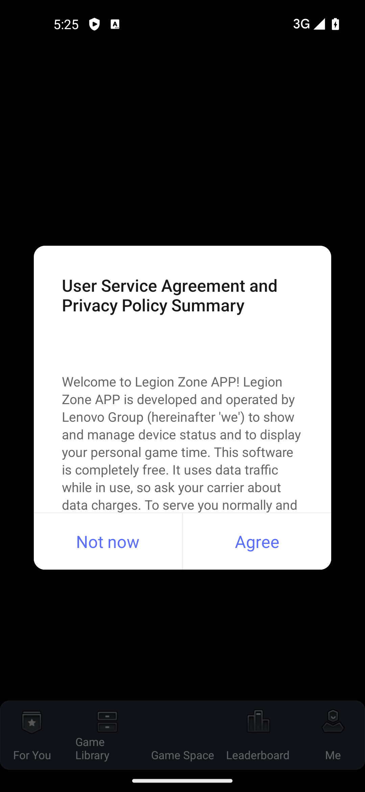
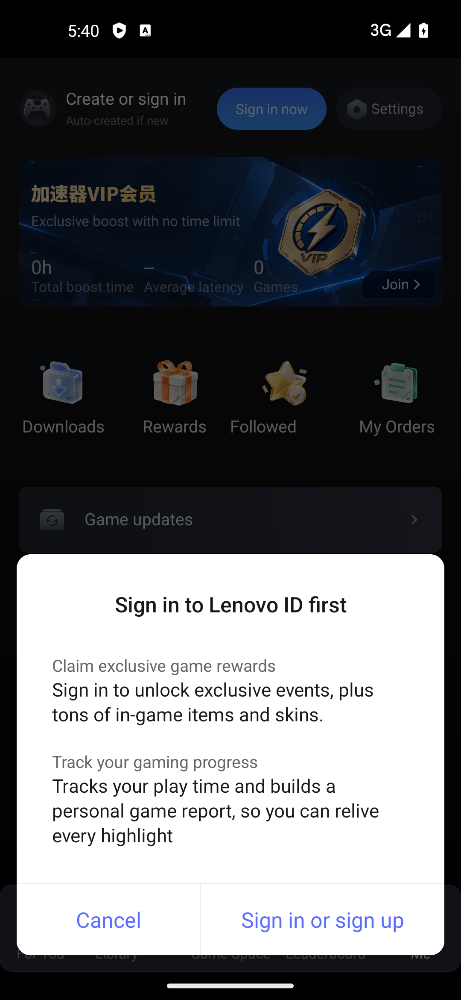
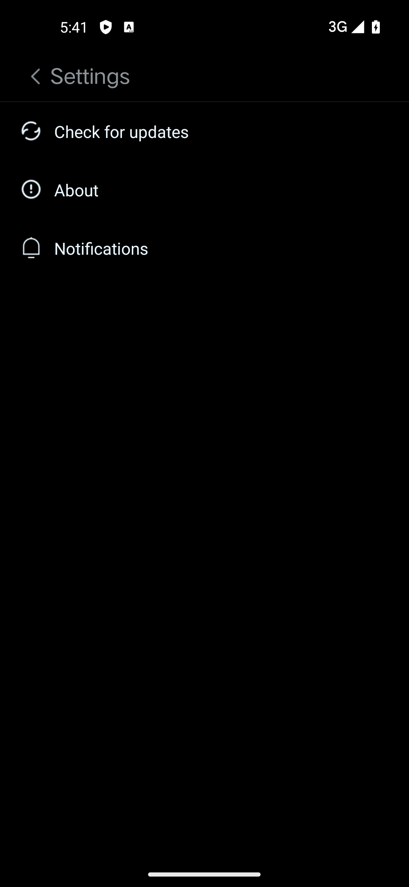
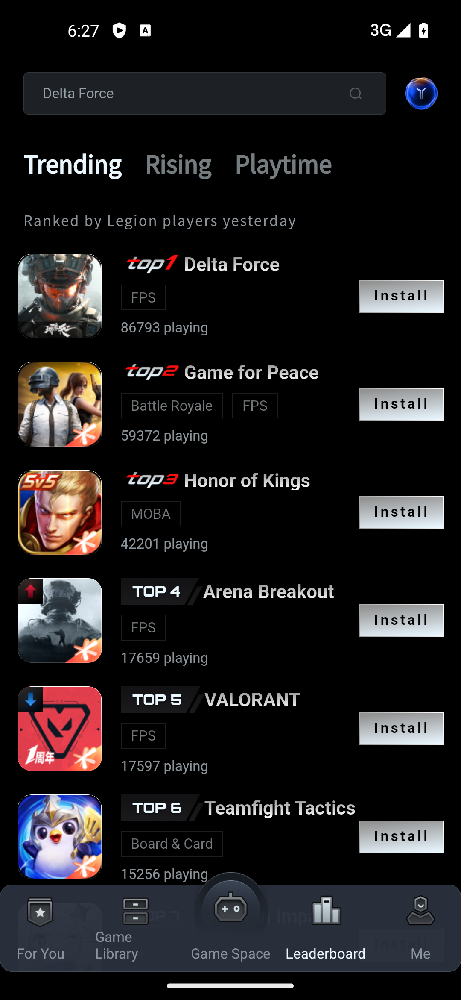

# Legion Zone 2.0.18.260907 — English builds

**[⬇ Download the APKs](https://github.com/b0r1s-69/LegionZone-EN/releases/tag/v2.0.18.260907-en)**

| Variant | APK | SHA-256 |
|---|---|---|
| 1 — clean | [LegionZone_EN_v1.apk](https://github.com/b0r1s-69/LegionZone-EN/releases/download/v2.0.18.260907-en/LegionZone_EN_v1.apk) | `e25294f8…68ea8` |
| 2 — web views translated | [LegionZone_EN_v2.apk](https://github.com/b0r1s-69/LegionZone-EN/releases/download/v2.0.18.260907-en/LegionZone_EN_v2.apk) | `9574feeb…81ab27` |

| | |
|---|---|
|  |  |
|  |  |


Two installable variants, same package, same signing key, same versionCode. They replace each other
with `adb install -r` (or a normal APK install) — pick the one you want, no uninstall needed between
them.

| | File | SHA-256 |
|---|---|---|
| **Variant 1 — clean** | `LegionZone_EN_v1.apk` | `e25294f8d91487999f6778d3d58fbe5e89e0a6deaffe431c74f9ce8783d68ea8` |
| **Variant 2 — web views translated** | `LegionZone_EN_v2.apk` | `9574feeb7fd8eb90ab3eab689c42bc7c0bf798207a80fd93cdc23ae47181ab27` |

Package `com.lenovo.legionzone` · versionName `2.0.18.260907` · minSdk 31 / targetSdk 33 · arm64-v8a
Signer: `CN=Legion Zone EN` (self-signed, SHA-256 `4947c477…89a4`)

---

## Variant 1 — clean

Everything the APK itself contains is English; nothing is injected at runtime.

| Layer | Count |
|---|---|
| Resource strings (all locales collapsed) | 1,099 unique → 1,256 pool entries |
| Layout attributes | 302 in 97 layouts |
| Hard-coded dex strings (`const-string`) | 700 unique → 865 call sites |
| Locale configs removed | 254 `ResTable_type` chunks (115 dirs) |
| Bundled H5 page `assets/h5_cache/ai-voice-ball` | now English (`Exit AI Game Companion`, `No network. Please Refresh / Retry`) |

Result: consent dialog, tabs, Me, Settings, About, permission dialogs, toasts, update check — English.
Web content stays Chinese (see below). **Use this if you want zero behaviour added.**

## Variant 2 — V1 + runtime translation of the WebViews

V1 plus a 8 KB JavaScript layer injected into every page load of the app's WebViews
(`WebFragment`, `VipActivity`, `CustomActivity`). It walks text nodes and translates by exact match,
plus count patterns, and re-runs on DOM mutations / route changes.

Measured on the leaderboard (Android 14 test device):

| Before | After |
|---|---|
| 火爆榜 / 飙升榜 / 时长榜 | Trending / Rising / Playtime |
| 榜单基于昨日拯救者玩家数量生成 | Ranked by Legion players yesterday |
| 安装 | Install |
| 86793人在玩 | 86793 playing |
| 吃鸡 / MOBA竞技 / 棋牌桌游 | Battle Royale / MOBA / Board & Card |
| 三角洲行动 / 和平精英 / 王者荣耀 | Delta Force / Game for Peace / Honor of Kings |
| 暗区突围 / 无畏契约：源能行动 / 金铲铲之战 | Arena Breakout / VALORANT / Teamfight Tactics |

Dictionary: ~230 entries (navigation, buttons, states, rewards, genres, top CN game titles) plus
9 regex rules for counts and relative dates.

**What V2 does not fix:** server sentences that are not in the dictionary (promotional copy, prize
descriptions, event text), and text baked into images (`游戏伙伴全新上线`, `加速器VIP会员`). Those are
pixels or arbitrary server prose, not text nodes — a client patch cannot rewrite them.

## Why the web layer is Chinese at all

Verified against the live backend, not assumed:

* H5 is served from `smartdl.lenovo.com.cn/frontend/legion-zone/...`; entry page declares `lang="zh-CN"`.
* The SPA bundle has **no i18n**: the only `en-US` / `zh-CN` strings are Element-Plus documentation URLs.
* No English build exists — `…/prod-en/`, `…/en/`, `…/intl/` all 404.
* Labels like `火爆榜`, `人在玩`, `天天领好礼` are **not in the JS bundle** — they arrive as server JSON.

So there is no language switch to flip; V2 is a display-layer translation, the only option that keeps
the app functional.

## Install

```bash
# first time only, if the official build is still installed (signature differs)
adb uninstall com.lenovo.legionzone

adb install LegionZone_EN_v1.apk     # or LegionZone_EN_v2.apk
```

Switching between the two afterwards: `adb install -r <other apk>`.

Note: the changed signing key means Play Store / Lenovo store updates cannot replace these builds —
useful, but it also means you must sideload future versions yourself.
